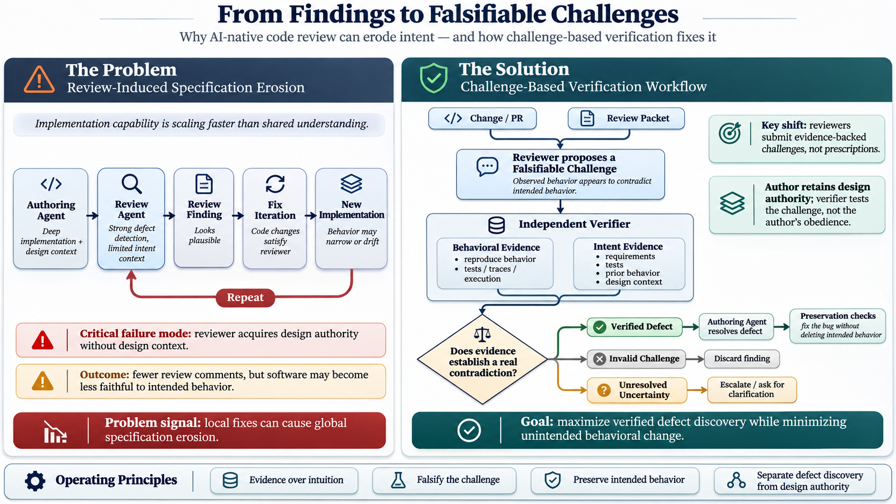

<div align="center">
  
  <h1>AI Code Review</h1>
  <p>Review changes by testing them against intended behavior.</p>
</div>

An automated reviewer can uncover a real defect with only a partial understanding of the design. A persuasive recommendation can also change a requirement the reviewer never saw. AI Code Review gives a repository-aware agent a concise brief to investigate the change and report falsifiable challenges. The author evaluates the evidence and decides what to change.

[](docs/assets/from-findings-to-falsifiable-challenges.png)

The diagram illustrates the evidence and decisions in the review process. The default workflow uses a brief and a checkout. A supplemental packet is available for reviewers with limited repository access.

## Install

Install Python 3.10 or later and Git, then run this from your clone.

```bash
python -m pip install -e .
```

## Review a change

Run the command from inside the repository, or pass its path as a positional argument. The brief goes to stdout by default. Use `--output review_prompt.md` to save it.

```bash
ai_review prompt
ai_review prompt --base main --head HEAD
```

- **Working tree.** `prompt` compares the staged and unstaged changes together against HEAD, or against the empty tree before the first commit. It includes untracked files that Git does not ignore, subject to the path filters. Use `--no-include-untracked` to limit it to tracked changes.
- **Branch comparison.** `--base` compares the merge base of the supplied refs with the review head. The head defaults to `HEAD`. Supply a base whenever you pass `--head`. Both refs and their shared history must be available locally.
- **Author context.** Repeat `--intent` for behavior or design decisions the reviewer should consider. Repeat `--context-file` for regular files to consult. Relative paths are resolved from the repository root and checked at the review target. The brief includes those paths as references.

For example, this brief points to this project's design for branch reviews.

```bash
ai_review prompt --intent "Branch reviews use the pinned head for structural context." \
  --context-file docs/TECHNICAL_DESIGN.md
```

## Run the reviewer

Give the brief to an agent with access to the checkout. It uses the diff, relevant callers, tests, and documentation to establish the intended behavior. Commit history and optional author notes can clarify what the change is meant to do.

For a single Grok review session, run the following from the repository.

```bash
python3 -m ai_review.cli prompt | grok --no-plan --no-subagents
```

In automation, pass the base and head refs and configure the agent to inspect the checkout without interactive approval. Author context remains optional. Check for a completed report before marking the job complete, since a tool permission error can end a headless run early.

## Read the outcome

Each challenge names the behavior in question and points to the affected code. It pairs a concrete observation with the evidence for a different expected result, then explains how the author can test both. The author decides whether the challenge holds and what behavior a correction must preserve. A short **Scope** note records what the reviewer inspected and any gap that affects confidence.

For example, a challenge could show that editing shared defaults clears an existing provider override, cite the documented precedence rule and the write path, and give a local check that exercises both updates. The challenge should preserve the requirement that providers without overrides still receive the new defaults. If the precedence rule is disputed or unavailable, the question belongs with the author.

**Unresolved questions** identifies material cases that need more evidence or a decision about intended behavior. **No material challenges established** records a completed review without enough evidence to advance a candidate. **Review blocked** identifies missing access or evidence that prevents meaningful investigation.

To reconcile multiple reports, run `ai_review synthesize-prompt ./reviews` on a directory of Markdown reports. Give the resulting brief to an agent to reconcile the evidence and surface disagreements that still need a decision.

## Supplemental commands

```bash
ai_review changes --max-diff-lines 2000
ai_review packet --base main --read-only
ai_review prompt --with-packet --read-only
ai_review analyze --full
```

| Command | Output |
| --- | --- |
| `changes` | A file summary and a bounded, redacted diff preview. Add `--include-untracked` to include untracked files in working mode. |
| `packet` | The change summary with structural context and review signals. In working mode, it includes untracked files by default. |
| `prompt --with-packet` | The review brief with a packet attached. Passing `--max-diff-lines` or either line-number flag also attaches a packet. |
| `analyze` | A structural guide written to `REPO_GUIDE.md` by default. Use `--full` to rebuild summaries or `--output` to choose a file. |

Use `prompt --chunked` to split a packet into Markdown prompts. For automation, send the chunks to stdout with `--chunk-separator nul`, or use `--output` to write numbered files.

Working-tree packets and `analyze` can use a local analysis cache. Pass `--read-only` to bypass that cache. For `analyze`, this also sends the guide to stdout unless you supply `--output`.

AI Code Review filters common sensitive paths and applies best-effort secret redaction to supplemental material. Agents that inspect the checkout directly should keep sensitive values out of reports.

See the [technical design](docs/TECHNICAL_DESIGN.md) for Git scope, preview limits, and analysis behavior.

## Development

```bash
python -m pip install -e '.[dev]'
python -m pytest
```

Structural analysis supports Python, JavaScript, JSX, TypeScript, and TSX. JavaScript and TypeScript use heuristics by default and use Tree-sitter when compatible versions of `tree_sitter<0.22` and `tree_sitter_languages` are installed.
